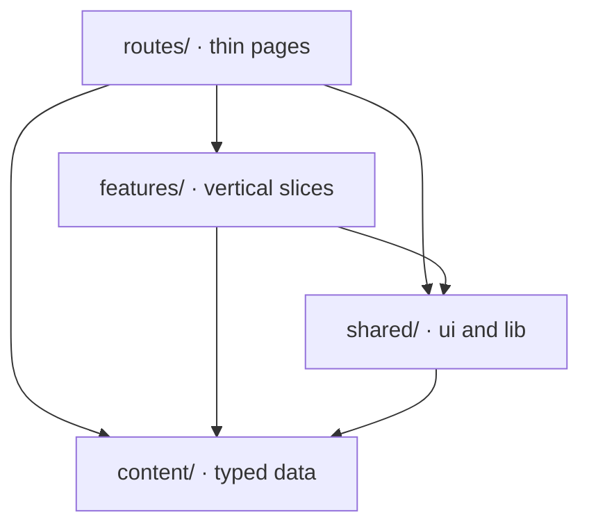
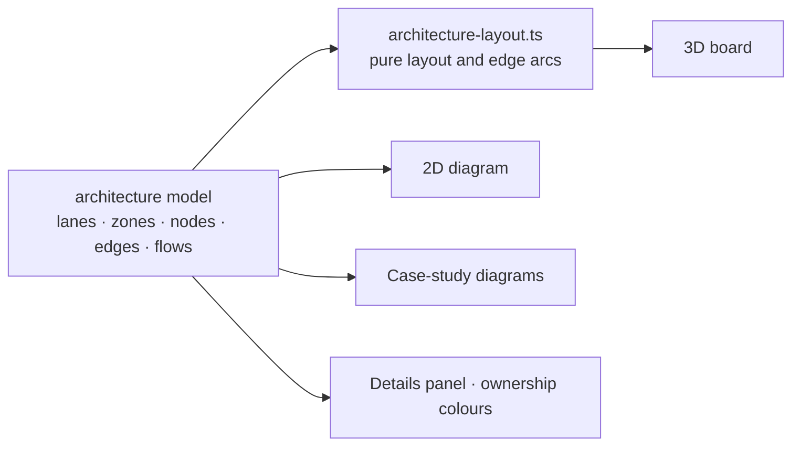

# Portfolio - Architecture & Roadmap

Design reasoning for the site. For the full list of technologies, features, current numbers
and the improvement backlog, see the [docs README](README.md); for the reasoning behind each
main choice, [DECISIONS.md](DECISIONS.md).

## 1. Goal

A portfolio that makes a senior engineer / architect say "lol, this is cool" in the first
three seconds, and then shows they **know how I think** within three minutes.

Most portfolios fail in one of two ways: they are pretty but shallow (a template with
logos), or deep but dull (a CV in HTML). This site gets past the first problem with one
signature visual moment, and past the second by presenting work the way an architect
works: **context → constraints → decisions → trade-offs → outcomes**, with an interactive
system diagram for each project.

**The site is itself a case study.** Its stack, CI gates, performance budget and design decisions are
public and linked from `/colophon`.

## 2. Experience design

| Moment      | What the visitor sees                                                                                                                                                                                                                                                | What it signals                      |
|-------------|----------------------------------------------------------------------------------------------------------------------------------------------------------------------------------------------------------------------------------------------------------------------|--------------------------------------|
| First paint | Name, headline and pitch as plain DOM (no WebGL needed); one action: "Explore my work"                                                                                                                                                                               | Performance discipline               |
| Once idle   | Matrix rain fades in behind the whole site and keeps falling as you scroll and change pages: vivid behind the hero, quiet behind text; a still frame under reduced motion. No WebGL on the home page                                                                 | Craft without cost                   |
| Work line   | Home is one scroll: a green line whose tip rides at 45% of the screen. Every main project is a full chapter; side projects and mentoring are one row each. Nodes and card edges light as the line arrives and revert when you scroll back; text never loses contrast | Progress, a career you can read      |
| Projects    | Main projects first, one per row, with counts; then side projects and mentoring                                                                                                                                                                                      | Breadth before depth                 |
| Project     | Footprint, highlights, technologies, then the board: 3D or 2D, zones, a symbol per type, owner colours, flows; screen-sized, full screen, hideable panel                                                                                                             | Systems thinking, honesty            |
| Case study  | Neon outcome tiles, interactive diagram, ADR-style decisions, retrospective                                                                                                                                                                                          | How I actually work                  |
| Principles  | Nine engineering rules, each linked to the case study that proved it                                                                                                                                                                                                 | Judgement, not just output           |
| Evidence    | Skills wired to the case studies that prove them                                                                                                                                                                                                                     | Evidence over self-rating            |
| Scroll      | Other pages: a progress bar under the nav and a numbered section rail                                                                                                                                                                                                | Orientation, polish                  |
| Search      | A bar in the nav over pages, projects, case studies and flow playback; `⌘K` jumps in                                                                                                                                                                                 | Built by a developer, for developers |
| `/colophon` | Stack, CI, decisions                                                                                                                                                                                                                                                 | Can defend every choice              |

Rules: no skill progress bars, no "95% JavaScript", no skill logos with nothing behind them.
Every claim links to evidence, and no diagram implies ownership of another team's work.
Projects carry no dates and no "current" badge.

Visual identity: **Matrix green** (`#00ff41`) on green-black surfaces, monospace eyebrows (`~/work`, `~/evidence`), neon
glow reserved for what is mine or in focus.

## 3. Information architecture

```
/                          Hero, then the work line: every project as a chapter (main, side,
                           mentoring) · principles · evidence · contact
/projects                  Main projects (one per row) with counts, side projects, mentoring,
                           then every case study by project
/projects/$project         Overview, footprint, highlights, technologies, board, case studies,
                           also delivered
                           · ?focus=<node> · ?flow=<flow> drive the board
                           · the board is wider than the text column and sized to the screen;
                             the details panel hides and the board can go full screen
/projects/$project/$study  Case study (outcomes, diagram, technologies, context, approach,
                           decisions, retrospective, previous / next)
/cv                        The CV from the same content; A4 black-on-white when printed
/resume.pdf                /cv printed by headless Chrome at build time (Grab my CV)
/colophon                  How this site is built + links to the decisions
*                          Themed 404
```

## 4. Stack

| Concern  | Choice                               | Why                                                                                                                      |
|----------|--------------------------------------|--------------------------------------------------------------------------------------------------------------------------|
| Build    | **Vite 8** (Rolldown)                | Fastest dev loop and builds; first-class static output for Pages                                                         |
| UI       | **React 19 + TypeScript (strict)**   | Richest ecosystem for 3D, motion and diagrams                                                                            |
| Routing  | **TanStack Router** (file-based)     | Typed params, search params and links; route-level code splitting                                                        |
| Styling  | **Tailwind CSS 4** + `@theme` tokens | Design tokens in one place; no runtime CSS-in-JS                                                                         |
| Motion   | **Motion**, native scrolling         | Declarative reveals; respects `prefers-reduced-motion`. Lenis was removed: it cost CPU on phones for no measured benefit |
| Fonts    | **Fontsource**, self-hosted          | No render-blocking third-party request; no visitor IPs sent to a font CDN                                                |
| Scroll   | **CSS scroll-driven animations**     | The work line runs in the browser, off the main thread ([decision](DECISIONS.md#a-scroll-driven-work-line))              |
| 3D       | **three.js + React Three Fiber**     | The project boards; lazy, paused off-screen; no helper library                                                           |
| Diagrams | **React Flow**                       | 2D views of the same architecture data; the 3D fallback                                                                  |
| Search   | **cmdk**                             | Accessible combobox for the nav search, whole-word matching                                                              |
| Content  | **Zod**-validated TS data            | Typed, refactor-safe, integrity-tested                                                                                   |
| Quality  | **Biome**, **Vitest**, `tsc`         | One fast lint+format tool; content tests; strict typecheck                                                               |
| Delivery | **GitHub Actions → GitHub Pages**    | Free; deploys only after every check passes                                                                              |

Alternatives considered: **Astro** (better SEO and zero-JS by default, but the experience
here is app-like and interactive throughout); **Next.js static export** (more framework
than a static host needs); **React Router** (fine, but weaker type-safety for links and
params).

## 5. Source layout

```
src/
  content/            ← the ONLY place to edit copy
    schema.ts         Zod schemas = the content model
    profile.ts  skills.ts  principles.ts  credentials.ts  career.ts  agent.ts
    projects/*.ts     one file per project; a project may own an architecture board
    case-studies/*.ts one file per case study, linked to its project
    index.ts          parse + derived indexes (skillById, projectBySlug, caseStudiesByProject…)
    content.test.ts   referential integrity + publishing safety
  routes/             TanStack file routes (thin: compose features)
  features/
    architecture/     Explorer (toolbar, panel, full screen), 3D scene, 2D diagram,
                      node details, legend, flow controls, focus rules, flow player
    workline/         the home page's line, chapters and compact project rows
    hero/  projects/  skills/  principles/  credentials/  career/  agent/  not-found/
    search/
  shared/
    lib/              board layout, diagram styles, textures, hooks (hover intent, in view /
                      near, idle, media queries), scroll helper, env checks (WebGL, Save-Data)
    ui/               nav, footer, section, section rail, scroll progress, metric tile,
                      agent parts, decoding text, social icons
  styles.css          Tailwind, design tokens, work-line CSS
docs/                 README.md (overview), this file, DECISIONS.md
scripts/              spa-fallback.mjs (404.html for deep links), build-resume.mjs (/cv → resume.pdf)
```

Dependencies only point one way: `routes → features → shared/content`. Features never
import each other.



## 6. Content model

**Projects** are engagements: a product or client.

- `kind`: `work` (main project) · `side` · `mentoring`
- `name`, `domain`, `role`, `accent`, `summary`, `highlights[]`, `skills[]`
- `links[]`: public pages about the product, such as its website
- `footprint[]`: `{ metric, value }` numbers shown as neon tiles
- `delivered[]`: work the commit history doesn't show (investigations, docs, an upgrade
  waiting in a pull request), each with a `shipped · ready · ongoing` status
- `architecture`: the explorable board (optional)

**Case studies** belong to a project (`project: "<slug>"`) and answer the same questions
every time, the way architects talk about work:

- `context`, `constraints[]`: the problem and the forces on it
- `approach[]`: what I did, in order
- `decisions[]`: `{ title, why, tradeoff }`, shown as mini-ADRs
- `outcomes[]`: `{ metric, value }`, the numbers
- `retrospective[]`: incidents owned and what I'd change
- `architecture`: the diagram (optional; required for featured case studies)
- `skills[]`: IDs into `skills.ts`; this drives the reverse index behind the evidence graph

**Architecture** is one model for every view ([decision](DECISIONS.md#one-architecture-model)):
`direction` (`LR` | `TB`), `lanes`, `zones` (groups of lanes, e.g. an AWS account or another
team), `nodes` with grid positions, a `kind` and an `owner`
(`built · contributed · integrated · platform · external`), typed `edges`, and `flows`
(step-by-step request walks). Nodes describe themselves as points (`features`, `tech`,
`myWork`) plus a one-line `note`; `short` is the label on dense views; `caseStudy` links a
box to its case study. `shared/lib/architecture-layout.ts` lays a layered diagram flat on a
board and computes edge curves; it is pure, so it's easy to test and reuse.



Adding a project or a case study means one new file and one line in `content/index.ts`.
Tests fail on a dangling reference (skill, slug, edge, flow step, lane, zone, case-study
link), a skill no project or case study proves, placeholder copy, or anything resembling an
internal hostname, ARN, account ID, private IP, env-var/queue name or ticket ID. Public
product websites are allowed.

## 7. Theme

All colours are tokens in the `@theme` block of `src/styles.css`:

| Token                                                            | Value                 | Use                                                            |
|------------------------------------------------------------------|-----------------------|----------------------------------------------------------------|
| `--color-matrix`                                                 | `#00ff41`             | Primary: links, buttons, the work line, "built or owned by me" |
| `--color-bg` / `--color-surface`                                 | `#050805` / `#0b110c` | Page and card backgrounds                                      |
| `--color-line`                                                   | `#1a2b1e`             | Borders, grid lines                                            |
| `--color-fg` / `--color-muted`                                   | `#e2f0e4` / `#82a088` | Text                                                           |
| `--color-violet`, `--color-amber`, `--color-sky`, `--color-pink` |                       | Legend categories only (contributed, third-party, edge types)  |

Project and case-study `accent` values are shades of the same green. Diagram owner and edge
colours live in `shared/lib/architecture-style.ts`; 3D floor and zone colours in
`features/architecture/ArchitectureScene.tsx`.

## 8. Performance & accessibility budget

| Metric          | Budget                                                                                      | How                                                                 |
|-----------------|---------------------------------------------------------------------------------------------|---------------------------------------------------------------------|
| LCP             | < 1.5s                                                                                      | Hero text is plain DOM; the rain is decorative and starts once idle |
| Initial JS (gz) | < 150 KB                                                                                    | three.js and React Flow are reached only through lazy imports       |
| CLS             | 0                                                                                           | Fixed hero height; skeletons for lazy blocks                        |
| Lighthouse      | ≥ 95 on all four categories                                                                 | Enforced in CI (roadmap)                                            |
| a11y            | Keyboard reachable, visible focus, reduced motion turns off 3D, smooth scroll and animation |                                                                     |

Current build (2026-10-29): initial JS ≈ 215 KB gz (React, router, motion, Zod and the
content in one entry chunk), **over budget**; CSS ≈ 10 KB gz; three.js ≈ 242 KB gz and React
Flow ≈ 58 KB gz, both lazy. The 3D board code is about 11 KB gz. Render loops pause when
their canvas is off-screen.

**Rules that keep it that way:**

- **No `manualChunks`.** A manual "three" chunk once pulled React into itself, so every page
  downloaded three.js and React Flow up front.
- **Fonts are never inlined into CSS.** Inlined fonts would block first paint.
- **The board loads only when the visitor scrolls near it.**
- **The home page loads no WebGL**: the hero's rain is a 2D canvas, started once idle.

Lighthouse (mobile emulation, local build), performance / accessibility / best practices /
SEO:

| Page         | Score                | Before  |
|--------------|----------------------|---------|
| Home         | 85 / 100 / 100 / 100 | 41 / 86 |
| Project page | 87 / 100 / 100 / 100 | 65      |
| Case study   | 83 / 100 / 100 / 100 | 68      |

The remaining gap is first paint, which waits for the entry chunk; the fix is prerendering.
See the [docs README §3-4](README.md#3-by-the-numbers).

## 9. Deployment

GitHub Pages has no server rewrites, so `scripts/spa-fallback.mjs` copies `index.html`
to `404.html`. Deep links like `/projects/foo` then still boot the app.
See [the decision](DECISIONS.md#spa-on-github-pages).

One-time setup: **repo → Settings → Pages → Source: GitHub Actions**.

## 10. Roadmap

**Phase 1: Skeleton** ✅
Routing, content model, hero scene, case-study template, skill graph, search, CI/CD.

**Phase 2: Content** ✅ (mostly)

- Projects as the top level: 7 main projects, 2 side projects, mentoring ✅
- 17 case studies from real work; 15 with a diagram, all with numbers ✅
- Six explorable boards, one for every main project but the Codexio contract work, with zones, per-type symbols,
  ownership
  colouring and flow playback; the media platform's board shows its migration, before
  and after ✅
- Work without commits ("also delivered"): investigations, documentation, an unreleased
  framework upgrade ✅
- AI work: agentic development and AI evaluation case studies ✅
- CV page and PDF generated from the content, with download buttons ✅
- Certifications and courses on the home page, their own page and the CV; LinkedIn in
  contact ✅
- Earlier roles and education on the home page and the CV; Codexio as two main projects,
  contract engineering and the ERP internship with its board ✅
- Still open: the current role's entry, the MIT course names, email and languages for
  the CV, detail for three main projects and mentoring

**Phase 3: Signature polish** (in progress)

- Home page as one scroll-driven work line; every client project in full, side projects and mentoring one row each ✅
- Hero: Matrix rain background, a headline that decodes once ✅
- Board: screen-sized, full screen, hideable panel, 2D tab, deep links, 2D first on phones ✅
- Matrix green theme ✅
- Performance and accessibility pass: Lighthouse home 41 → 85, accessibility 100 ✅
- Next: an at-a-glance summary on every project and case study, flow text summaries,
  keyboard navigation on the board, flow playback inside case-study diagrams

**Phase 4: Proof of engineering**

- Prerender static routes to HTML; per-page metadata, sitemap, link previews
- Playwright smoke + visual regression; axe accessibility checks
- Lighthouse CI + bundle-size budget as PR gates

The full, prioritised backlog with effort estimates lives in
[docs README §4](README.md#4-what-we-can-improve).
