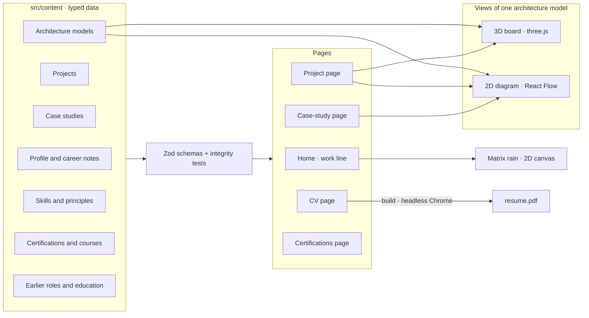
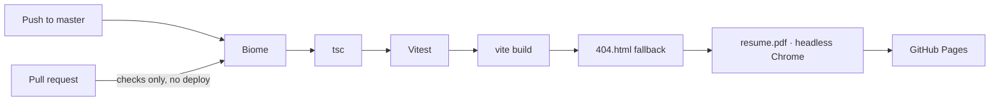

# Portfolio: what it's built with, what's built, what's next

One page that answers three questions: **which technologies the site uses**, **what has been
built**, and **what would make it better**. For design reasoning see
[ARCHITECTURE.md](ARCHITECTURE.md); for the reasoning behind
the main choices see [DECISIONS.md](DECISIONS.md).

Measured on 2026-10-29 from the `portfolio-v2` branch (the live site on `master` still shows
the old template until this branch is merged).

## At a glance

How the content becomes every page, every view and the CV:

---

## 1. Technologies

| Layer          | Technology                            | Version     | Used for                                                                                    |
|----------------|---------------------------------------|-------------|---------------------------------------------------------------------------------------------|
| Build          | **Vite** (Rolldown)                   | 8.3         | Dev server, production build; heavy views split by lazy imports; fonts never inlined        |
| Language       | **TypeScript**, strict                | 7.0         | Everything; `tsc --noEmit` gates CI                                                         |
| UI             | **React**                             | 19.3        | Components, `lazy` + `Suspense` for heavy views                                             |
| Routing        | **TanStack Router**, file-based       | 1.170       | Typed routes, params and search params (`?focus`, `?flow`), auto code-splitting, redirects  |
| Styling        | **Tailwind CSS** + `@theme` tokens    | 4.3         | Design tokens (Matrix palette) in one place, no runtime CSS-in-JS                           |
| Motion         | **Motion**                            | 14          | Reveals and transitions; off under reduced motion                                           |
| Scroll effects | **CSS scroll-driven animations**      | native      | The home page's work line (`animation-timeline: view()`), no JS per frame; native scrolling |
| 3D             | **three.js** + **React Three Fiber**  | 0.186 / 9.8 | The 3D architecture boards on project pages; no helper library (no drei)                    |
| 2D diagrams    | **React Flow** (`@xyflow/react`)      | 12.12       | 2D boards, every case-study diagram, the 3D fallback                                        |
| Search         | **cmdk**                              | 1.1         | The nav search bar (`⌘K` / `Ctrl K` jumps in)                                               |
| Content        | **Zod**                               | 4.6         | Schemas for all content; parsed once, integrity-tested                                      |
| Fonts          | **Fontsource**, self-hosted           | 5.3         | Inter Tight (variable) and JetBrains Mono 400/600; browsers fetch only the Latin files      |
| Lint + format  | **Biome**                             | 2.5         | One tool for lint and format                                                                |
| Tests          | **Vitest**                            | 5.0         | 143 content and diagram integrity tests, publishing-safety checks                           |
| CI/CD          | **GitHub Actions** → **GitHub Pages** | —           | Lint → typecheck → test → build → deploy, on `master` only                                  |
| CV PDF         | **puppeteer-core** + system Chrome    | 25          | Prints `/cv` to `resume.pdf` at build time                                                  |
| Tooling        | pnpm 9, Node ≥ 22.12                  | —           | `.nvmrc`, frozen lockfile in CI                                                             |

Not dependencies, used locally for checks: headless Chrome via puppeteer-core (screenshots,
hover-stability sampling) and Lighthouse 12.

---

## 2. What's built

### Pages

| Route                       | What it shows                                                                                                                                                                                 |
|-----------------------------|-----------------------------------------------------------------------------------------------------------------------------------------------------------------------------------------------|
| `/`                         | Hero, then **the work line**: every main project in full, side projects and mentoring one row each, then problem solving, evidence, experience and education, certifications and contact      |
| `/projects`                 | Main projects one per row with counts, side projects, mentoring, then every case study grouped by project                                                                                     |
| `/projects/$project`        | Overview, footprint tiles, highlights, **technologies**, the **architecture board**, case studies, "also delivered"                                                                           |
| `/projects/$project/$study` | Outcome tiles, interactive diagram, technologies, context, constraints, approach, decisions (mini-ADRs), retrospective, previous / next                                                       |
| `/cv`                       | The CV, built from the same content; black on white and A4 when printed, with a **Grab it ↓** button under "This is the CV you're looking for."                                               |
| `/resume.pdf`               | The CV as a PDF, printed from `/cv` by headless Chrome at build time                                                                                                                          |
| `/certifications`           | Certification badge cards, then certificates (with their courses), courses and events, each linking to where it can be verified                                                               |
| `/colophon`                 | How the site is built, linking to the decisions                                                                                                                                               |
| `*`                         | Themed 404: an animated agent in sunglasses looks around an empty room and shrugs (`features/not-found/LostAgent`, still with reduced motion), and the missing path is shown as a shell error |

### Home: the work line

- A vertical green line runs down the page; its tip rides at 45% of the screen.
- **Every main project is a full chapter**: role, summary, footprint, highlights, stack,
  case studies, and links to its page and its architecture board. **Side projects and
  mentoring** are one compact row each. `featured: true` (the auction SaaS, Insurance API
  platform) only gives those two the longer entry on the CV.
- **Neon cards**: project cards and principles are frosted glass over the rain (blurred on
  wide screens), with HUD corner brackets and a spotlight in the card's accent that follows
  the pointer. Rows, case-study links and buttons glow in their own accent on hover.
- **Number tiles** (the counters, project footprints and case-study outcomes) brighten under
  the pointer, with a spotlight that follows it; each tile reacts on its own, never with the
  card around it, and nothing moves or resizes.
- **Technologies grouped by area** (`shared/ui/TechStack`): each area labelled in its colour,
  each chip lighting up in that colour on hover; the same component on project pages.
- Each chapter's node and card edge light as the line reaches them, and items take their
  colour; it all reverts when you scroll back. **Text keeps full contrast in every state**:
  only colour and decoration change.
- Pure CSS (scroll-driven animations). Without browser support, or with reduced motion,
  everything renders fully lit. See [the work-line decision](DECISIONS.md#a-scroll-driven-work-line).

### The 3D architecture board

The signature view, on every project that has an `architecture` (the auction SaaS,
Insurance API platform, Media management platform, Automotive collaboration platform,
National water management system).

- **An isometric board, not a stack**: one floor under an orthographic camera at a fixed
  axonometric angle. Zones (an AWS account, another team, third parties) are outlined
  regions with their titles printed on the floor; lane names are floor text.
- **One symbol per component type**: stacked blades = services, cubes = Lambdas, a hexagon =
  the event bus, plates = queues, cylinders = data stores, flat tiles = clients, dashed
  ghosts = third parties. Dark glass with edge outlines; glow is additive sprites.
- **Ownership colour on every box**: green = built or owned by me, violet = contributed,
  grey = other team / managed infrastructure, amber = third-party. "Highlight my work"
  dims everything else.
- **Traffic**: edges are arcs with moving packets, coloured by type (HTTPS, event, queue,
  AI / internal API, read / write).
- **Flows**: "walk through a request" follows one request end to end, step by step, with captions (e.g.
  export an auction, analyse photos, download a 37 GB workspace, delete a workspace).
- **Details panel**: click a box for points, not prose: what it does, what it runs on,
  what part was mine, plus a link to the case study that explains it.
- **Controls**: drag to rotate, right-drag to pan, `Ctrl` + scroll to zoom, zoom and reset
  buttons; on phones, swipe to rotate and tap a box.
- **Room to work**: the board is wider than the text column and sized to the screen (`100svh` minus the header); the
  details panel can be hidden and the board can go **full screen**.
- **Deep links**: `?focus=<node>` selects a box, `?flow=<flow>` starts a flow.
- **Stable under the pointer**: hover never moves or resizes anything (lift and expanded
  labels only on select or flow step), plus a hover-intent grace period. This removed a
  blinking feedback loop.
- **Loads only when needed**: the board's code (three.js or React Flow) is fetched when the
  visitor scrolls near it, never with the page. Paused when off-screen.
- **Phones open the 2D view**: 28 boxes in 3D are too small at 390 px; 3D is one tap away.
- Labels are DOM buttons projected every frame, so they stay crisp and keyboard-focusable.

### 2D diagrams

- The same data rendered with React Flow: lanes as bands, boxes coloured by owner with a type
  icon, typed and animated edges, legend.
- The **2D tab** on every board, the default on phones, and the **only** view on case-study
  pages (15 diagrams).
- Wide left-to-right diagrams turn top-to-bottom on phones. On phones a large board starts
  at a readable zoom, centred on the core services, instead of shrinking to fit; pan and
  pinch for the rest.
- Busy diagrams hide edge labels until an edge is in focus; the view re-fits whenever its
  frame changes size.
- The fallback when WebGL is missing or reduced motion is on.

### Hero

- `> the Matrix has you…` above the name (from Neo's screen in the film, like the scroll
  cue's white rabbit), then the title with a joke as
  a code comment (`// takes the red pill on every bug`), and a winking intro (`profile.intro`; the CV keeps the straight
  `pitch`). No years and no tech
  chips here: the counters and every project show those. All plain DOM first.
- **Decoding on arrival** (`shared/ui/DecodeText`): on the first screen of a visit, the nav
  and every hero line resolve from random letters and digits in a cascade (nav, prompt, name,
  title, intro, buttons, scroll cue). The real text holds the layout while the noise is drawn
  over it, so nothing shifts; one shared timer drives them all; later navigation shows plain
  text; reduced motion skips it. A/B in the same session: Lighthouse is the same with or
  without it.
- The background is the site-wide Matrix rain (below); no 3D on the home page, so three.js
  never loads there.
- **Explore my work ↓** and **Grab my CV ↓** (the PDF; the label doesn't need to say so), plus a scroll cue ("follow the
  white rabbit"): a light falling down a
  thin line into the work line below.
- **The agent** (`features/hero/HeroAgent`), the same character as the 404 page, beside the
  text on wide screens and under the buttons on phones. He waves hello, then types at a
  holographic keyboard while code scrolls on a floating screen; his head follows the pointer;
  hovering **Explore my work** makes him point down and **Grab my CV** makes him hold up the
  CV; a click or tap plays thumbs up, coffee, a deploy and a wave in turn; under the pointer
  he waves and types "the chosen one" (the docked agent and the nav mark say it too, from
  `agentLines.hover`). Hand-drawn SVG with
  CSS keyframes, no library. He arrives once the page is idle into space reserved from the
  start (no layout shift), pauses off-screen, stands still with reduced motion, and his loops
  run in steps to keep repaints cheap. Measured: Lighthouse is the same with or without him.
- **The docked agent** (`features/agent/AgentDock`) is the same character holding an open
  laptop, on every page. He jumps into the right-hand page margin (bottom corner) once the
  hero is scrolled past, and back out when it returns; on other pages he jumps in when the
  page settles. While you scroll he turns to the content and glances the way it moves; his
  head follows the pointer; when a section reaches the top of the screen a speech bubble
  says a line from `content/agent.ts` (the last section speaks at the bottom of the page; a
  page can have its own greeting, like the CV's "Let's work together and build something
  awesome!"):
  each project has its own joke the first time (a pun that fits it, not a fact the page
  already shows), then quips take turns, so he doesn't repeat;
  a click makes him wave and reply. He appears only from 1400 px wide, where the margin has
  room, so he never covers text; he steps aside while the hero, the 404 page's agent (`data-agent-home`) or a wide
  architecture board (`data-agent-avoid`) is on screen. His ×
  hides him, remembered in local storage; **Show the agent** in Search brings him back.

### Background: Matrix rain on every page

- One 2D canvas, no library, fixed to the screen behind every page: the content scrolls over
  it and the rain keeps falling. It lives in the root layout, which never unmounts, so it
  carries on across page changes instead of restarting.
- Glyph heads glow near-white and trails fade green; at most one glyph per column per frame
  at 24 fps; paused in background tabs; a single still frame under reduced motion.
- **Vivid at the top of the home page, a quiet texture everywhere else**, so long text stays
  easy to read. The switch is a 700 ms opacity transition as you scroll past the hero.
- It starts once the first page is idle and fades in; hidden when printing, so the CV PDF
  never shows it. The canvas uses `lvh`, so a phone's address bar sliding away doesn't
  resize it and restart the rain.
- Measured with it running: home Lighthouse 87, a case study 81 (performance; accessibility
  stays 100).

### Navigation and orientation

- **Nav**: the agent's head as the logo mark (it follows the pointer too) beside the name,
  which glows green and turns green on hover, when the head says "the chosen one"; then Work, Projects, CV,
  Certifications, How it's built, with the search bar in the middle, then LinkedIn, Facebook and Instagram as small
  outline icons that glow on hover (`shared/ui/SocialIcon`).
- **Search** (`features/search/SiteSearch`): a bar in the middle of the nav, no dialog. Type and
  matches appear under it: pages, sections, projects, case studies, every board's walkthroughs,
  the CV and profiles. Each typed word must start a word in the result (plurals count), and
  projects and case studies match on their technologies too, so "Kafka" finds the Kafka
  projects. While idle, the placeholder rotates: "Are you looking for me?", then lines
  from The Matrix ("What is the Matrix?", "Free your mind.", "Welcome to the real world."). `⌘K` / `Ctrl K` jumps in,
  Esc clears. Below the large breakpoint a magnifier opens
  the bar across the nav.
- **Scroll progress bar** under the nav (off on the home page, where the work line does
  that job) and a numbered **section rail** on long pages.
- Native scrolling; in-page jumps glide, and jump instantly under reduced motion.

### Evidence and principles

- **Evidence graph**: skills on one side, case studies on the other, wires between them.
  Hover a skill to see where it was proven. No self-rated bars. Unrelated cards recede by
  colour, never below readable contrast. The status line above the list keeps a fixed
  two-line height, so hovering a card never shifts the list under the pointer.
- **Problem solving** (`#problem-solving`, the principles): nine engineering rules, each linked to the case study that
  proved it.

### Certifications and courses

- **Certifications as badge cards**: the four Oracle certifications, each with its badge,
  opening its Credly verification page. Same neon card as the projects (HUD corners,
  spotlight, glow on hover).
- **Certificates, courses and an event** as a compact list underneath: issuer, year and a
  short note (a grade, what a certificate covers), linking to the Coursera or SoftUni
  verification where one exists.
- Only credentials show a year; projects stay undated. The raw certificate files stay out of
  the repository (`certificates/` is gitignored): the site links to the issuers instead.
- **Their own page** (`/certifications`, in the nav from tablet width, in search and
  linked from the home chapter): the same badge cards, then certificates, courses and events
  under their own headings. The Google certificate lists its five courses, each with its own
  Coursera verification.
- The CV lists the certifications and the Google certificate, then the graded courses by
  name and a count of the rest, linking to `/certifications` for the full list.
- **LinkedIn**, **Facebook** and **Instagram** are the profile links, in the contact section, the footer on
  every page and search; the CV header shows LinkedIn only (`cv: false` on the others).
  There is no separate GitHub link: the site's own address already carries it.

### Experience and education

- A home chapter before the certifications (`#experience`): **earlier roles** (Software
  Engineer at Codexio, Sales Specialist at Agroconsult Engineering) and **education** (a
  bachelor's degree in Business Economics from Trakia University, master's-level courses
  from MIT, SoftUni (top 3 at the time, a teaching-assistant offer, an internship at Codexio
  while still in Fundamentals), Telerik Academy courses, and conferences and
  meetups (jPrime and DEV.BG All in One almost every year, BG JUG; site only)), as neon cards
  without dates, each linking to the employer or school. Codexio
  has no card there: its two project chapters already tell it. The Agroconsult card lists the
  role's scope (from machine technician to manager of five, transport contracts and
  international deliveries, on-site machine repairs across Bulgaria); a third card covers
  three seasons of J-1 work and travel in the USA (dishwasher to second cook at a Cody,
  Wyoming steakhouse, working with people from all over the world). It stays off the CV.
- **Codexio** is the last two main projects: **contract engineering** (placements at client
  companies in positions from mid-level to senior: a social travel app's search, microservice
  features for a virtualization software company, a Flutter app; clients kept anonymous) and
  the **ERP internship**, whose board shows the Angular web app and the Flutter mobile app,
  inventory and sales services over TCP, a WebSocket chat, service discovery with its
  availability check, and the ELK stack. Only what is remembered is drawn.
- The CV shows earlier roles and education side by side, between the projects and the
  certifications. Both Codexio projects are told there, under the role, rather than as
  project entries, which keeps the CV to two pages.

### Content model and safety

- All copy lives in `src/content` as Zod-validated TypeScript: profile, skills, principles,
  credentials, projects, case studies, architectures.
- **Projects** (`work` · `side` · `mentoring`, optionally `featured`) own **case studies**;
  a project may own an architecture board, `footprint` numbers and `delivered` items (work
  without commits: investigations, docs, an upgrade waiting in a pull request).
- **One architecture model** drives the 3D board, the 2D view and every
  case-study diagram ([decision](DECISIONS.md#one-architecture-model)).
- **143 tests** check every reference (skills, slugs, edges, flow steps, lanes, zones,
  case-study links, a role's project), that every skill is proven somewhere, that every certification has its
  badge and a verification link, and that nothing placeholder or
  internal ships: hostnames, ARNs, account IDs, private IPs, env-var or queue names and
  ticket IDs all fail the build, and so does naming the employer's products.

### Theme

- **Matrix green**: `--color-matrix: #00ff41` on green-black surfaces (`#050805`), used as
  `text-matrix`, `bg-matrix`, `border-matrix/40` and so on. Kept at full strength, glow
  included (decided 2026-10-29).
- Project and case-study accents are shades of the same green. Violet, amber and blue are
  kept only where a legend needs distinct categories.
- All tokens live in the `@theme` block of `src/styles.css`.

### Quality and delivery

- `pnpm verify` = Biome + `tsc` + Vitest + build, exactly what CI runs.
- Pushing to `master` deploys to GitHub Pages; pull requests run the checks only.
- `scripts/spa-fallback.mjs` copies `index.html` to `404.html` so deep links boot the app.
- `scripts/build-resume.mjs` prints `/cv` to `resume.pdf` with headless Chrome (`puppeteer-core`, the system Chrome) and
  fails the CI build if it can't.

---

## 3. By the numbers

**Content**

|                                   | Count                                                                                                                                       |
|-----------------------------------|---------------------------------------------------------------------------------------------------------------------------------------------|
| Projects                          | 10 (7 main, 2 side, 1 mentoring); 2 flagships                                                                                               |
| Case studies                      | 17 (10 featured; 11 auction SaaS, 5 Insurance, 1 media migration)                                                                           |
| Explorable boards (3D + 2D)       | 6: Auction SaaS (28 boxes, 4 flows), Insurance API (23, 3), Media (10, 3), Automotive (11, 3), Water (16, 3), Codexio ERP internship (7, 3) |
| Case-study diagrams (2D)          | 15                                                                                                                                          |
| Boxes / connections, all diagrams | 198 / 241 (19 flows)                                                                                                                        |
| Skills / principles               | 44 / 9                                                                                                                                      |
| Credentials                       | 18: 4 certifications, 1 professional certificate (5 courses), 12 courses, 1 event                                                           |
| Earlier roles / education         | 3 / 5 (the J-1 seasons and the conferences card are on the site only)                                                                                                                                       |

**Bundle**

| Chunk                                           | Size (gzip)       | Loaded                                     |
|-------------------------------------------------|-------------------|--------------------------------------------|
| App entry (React, router, motion, Zod, content) | 215 KB            | Always                                     |
| CSS                                             | 10 KB             | Always                                     |
| Fonts                                           | 87 KB (3 × woff2) | Always; Latin files only                   |
| three.js                                        | 242 KB            | 3D board when near; never on the home page |
| React Flow                                      | 58 KB             | 2D views, when near                        |
| 3D board code (incl. React Three Fiber)         | 11 KB             | With three.js                              |

**Lighthouse** (lab run, mobile emulation, local production build, 2026-10-29)

| Page                   | Performance | Accessibility | Best practices | SEO | Blocking time  | Largest paint |
|------------------------|-------------|---------------|----------------|-----|----------------|---------------|
| Home                   | 41 → **85** | 86 → **100**  | 100            | 100 | 1,580 → 180 ms | 5.4 → 3.3 s   |
| Project (auction SaaS) | 65 → **87** | 100           | 100            | 100 | 120 → 130 ms   | 5.7 → 3.2 s   |
| Case study             | 68 → **83** | 100           | 100            | 100 | 50 → 70 ms     | 5.3 → 3.7 s   |

What changed the numbers:

- **The biggest win: a chunk-splitting bug.** The old `manualChunks` rule had pulled React
  into the "three" chunk. That made every page download three.js and React Flow up front:
  about 300 KB gz, on every page.
- **The home page's 3D scene:** it now waits until the page is idle, and phones skip it.
- **Contrast:** dimmed work-line items and evidence-graph cards now keep their text readable.
- **Smaller fixes:** the footprint `<dl>` nesting is fixed, fonts are self-hosted, and Lenis
  is gone.

What remains: first paint still waits for about 215 KB of JavaScript (about 3 s on an
emulated mid-range phone). Prerendering is the fix (see §4).

---

## 4. What we can improve

Merged from this list and an external review of the site, with the decisions taken on
2026-10-29:

- **Home page:** hybrid. Featured projects stay full chapters on the work line; everything
  else gets one row.
- **Experience:** shown as roles without dates. Projects carry no years; only certifications
  and courses show the year earned.
- **CV:** generated from the site's own content, so the page and the PDF never drift apart.
- **Theme:** Matrix green stays as it is.

Effort: **S** = under an hour · **M** = half a day · **L** = a day or more.

### Done (2026-10-29)

- [x] Home accessibility 86 → 100: work-line items and evidence cards keep text contrast.
- [x] Footprint `<dl>` structure (`MetricTile` takes a class instead of an extra wrapper).
- [x] No WebGL on the home page: the hero is Matrix rain on a 2D canvas, started once idle.
- [x] The board loads when the visitor scrolls near it.
- [x] Fonts self-hosted (Fontsource), never inlined into CSS.
- [x] Lenis removed; native scrolling.
- [x] Chunking fix: three.js and React Flow no longer load on every page.
- [x] Phones open boards in 2D, at a readable zoom.
- [x] Hybrid home page: every client project in full, side projects and mentoring one row each.
- [x] **CV, first version**:
    - a `/cv` page built only from existing content: summary, skills by area and the five
      client projects (outcomes, side projects and mentoring left out on purpose; GitHub is
      not repeated, the site's address already carries it);
    - on screen, skill rows and project entries light up in their own neon colour under the
      pointer, with a spotlight that follows the mouse;
    - `/resume.pdf` printed from that page at build time: A4, plain black on white, selectable
      text, links to the public site, about 1½ pages;
    - "Grab my CV ↓" in the hero and the contact section, "CV ↓" in the footer; "CV" in the nav;
      both in search.

### Done (2026-10-30)

- [x] **Certifications and courses**: a home chapter before contact (Oracle badge cards
  linking to Credly, then certificates, courses and an event), a CV section, and a search
  entry.
- [x] **LinkedIn** in the contact section, the footer and the CV header.
- [x] **Certifications page** (`/certifications`), grouped by kind, with the Google
  certificate's five courses; the home chapter stays and links to it.
- [x] **Experience and education**: earlier roles and education on the home page and the CV,
  without dates.
- [x] **Codexio** as the last two main projects: contract engineering, and the ERP
  internship with its board and three flows; the role links to both, and on the CV they sit
  under Earlier roles. New skill: Flutter.
- [x] "Projects" instead of "main client projects" in the titles and counters: an
  internship isn't client work.
- [x] **Earlier roles and education, filled in**: Agroconsult (machine technician to manager
  of five), three J-1 seasons in the USA (site only), SoftUni (top 3), Telerik Academy and
  conferences (site only).
- [x] **The agent**: the hero scene, a docked companion on wide screens that comments on
  sections with project jokes, his head as the logo mark ("the chosen one" on hover), and
  the lost agent on the 404 page. Lines live in `content/agent.ts`.
- [x] **Hero copy**: "> the Matrix has you…", the title with `// takes the red pill on every
  bug`, a winking intro (the CV keeps the straight pitch), "follow the white rabbit"; no
  years or tech chips. Everything on the first screen decodes from noise on arrival.
- [x] **Header**: the name glows green; LinkedIn, Facebook and Instagram as icons; no GitHub
  link (the address already carries it).
- [x] **Search as a bar** in the middle of the nav, no dialog: whole-word matching, Matrix
  lines as the placeholder, a magnifier on small screens.
- [x] **The employer stays unnamed**: the auction SaaS and its data platform appear without
  product names or links (slug `auction-saas`); a publishing-safety test enforces it.
- [x] **Number tiles** react to the pointer; the evidence graph no longer flickers on hover.

### A. Needs your input (professional clarity, do first)

- [ ] **Current role**: whether it gets its own entry under Experience (Codexio is done,
  see Done). **S**
- [ ] **MIT courses**: the course names and where they were taken (MITx on edX, or another
  programme), so the education entry can name them and link to a verification. **S**
- [ ] **Complete the CV**. The page and PDF exist, with LinkedIn, earlier roles, education
  and certifications (see Done); still missing: the email to publish and languages. Each appears in the CV as soon as it
  is in the content. **S**
- [ ] **Contact on every page**: LinkedIn is in the contact section and the footer; the
  email still needs to go next to it. Check every link, the PDF and the `mailto:` in production. **S**
- [x] **Hero specialisation line**: now the title with its `// tagline` and the intro.
- [ ] **AI product names** (PIQ, ConditionIQ, Price Predictor): make them generic like the
  employer, or keep them? The PIQ case study's address names it too. **S**
- [ ] **Case studies for the former thin projects.** All three now have boards:
    - **Media management** is a before/after migration board, and its case study has been
      rewritten from your answers: the rewrite from scratch, the migration tool, a direct
      switch, and the first month alone.
    - **Automotive collaboration** (Kafka, CQRS, ELK) and **water management** (Kafka with
      consumer groups and dead-letter topics, PostGIS, GeoServer, JWT) each still need a
      case study built around one concrete problem or decision. **M each**
- [ ] **Mentoring mini case study** for Paysafe: format, topics, outcomes, scope. **S**
- [ ] **About**, short: photo (optional), languages, location / remote preference,
  availability only if you want it public. **S**
- [ ] **Recommendations**: two or three, with explicit permission and attribution. **S**
- [ ] More side projects (ProcureLab, node-internals-lab, the kindergarten app). **S each**

### B. Next engineering steps (no input needed)

- [ ] **Prerender every route to static HTML** at build time, keeping React hydration.
  First paint about 3 s → about 1 s on phones, deep links return 200, and every page gets its
  own HTML. Options: a headless-Chrome prerender step, `vite-react-ssg`, or TanStack
  Start's static prerendering. **M-L**
- [ ] **Per-page titles, descriptions and canonical URLs**, plus `sitemap.xml`, JSON-LD
  `Person`, and `robots.txt` pointing to the sitemap. **S-M** (pairs with prerendering)
- [ ] **Link previews**: an Open Graph image per project and case study, validated on
  LinkedIn and Slack. **M**
- [ ] **Shrink the entry chunk** (215 KB gz against a 150 KB budget): keep Zod in tests and
  the build, ship plain data; check what else the first page doesn't need. Then set the
  budget and enforce it. **M**
- [ ] **At-a-glance summary on project and case-study pages**: problem · my role and
  scope · constraints · approach · decision and trade-off · outcome · looking back, in the
  same order everywhere, before diagrams and long prose. Plus a short non-technical line. **M**
- [ ] **Board wording and alternatives**:
    - a "What this demonstrates" line above each board;
    - clearer labels: "Explore the system architecture", "Walk through a request";
    - a text summary of each flow for people who don't want to interact;
    - clear play / pause / reset controls. **S-M**
- [ ] **Keyboard navigation on the board**: arrow keys between connected boxes, `Enter`
  for details; verify focus order and labels with a screen reader pass. **M**
- [ ] **Flow playback in case-study diagrams**, not only on project boards. **M**
- [ ] **Navigation once Experience and CV exist**: Work · Experience · About · CV, with
  All projects, case studies and How it's built as secondary (footer). Search stays in
  the middle of the nav. **S**

### C. Proof of engineering (CI)

- [ ] **Playwright smoke suite**: home, one project, one case study, `/cv`, a deep link, 404. **M**
- [ ] **axe checks** on those routes in CI. **S**
- [ ] **Lighthouse CI budgets**: an alert first, then a gate once the numbers are stable. **M**
- [ ] **Visual regression** for the 2D and 3D board, including hover stability. **M**
- [ ] **Unit tests where the logic is real**: board layout, focus rules, the flow player. **S-M**
- [ ] **Preview deploys for branches** (Pages only deploys `master`). **S**
- [ ] **Renovate or Dependabot**, and a Content-Security-Policy meta tag. **S**

### D. Optional, only with real material

- [ ] Two technical articles drawn from the strongest case studies (no empty blog). **L**
- [ ] Privacy-friendly analytics, only if the data will be acted on. **S**
- [ ] A custom domain instead of `itenev23.github.io`. **S** (+ yearly cost)
- [ ] Print-friendly case studies for interviews. **S**
- [ ] Project filters, if `/projects` becomes hard to scan. **S-M**
- [ ] View Transitions for card → page, after performance and accessibility hold. **M**

### Not doing

- Terminal easter egg, AI résumé chatbot, extra 3D scenes.
- Skill percentage bars or badge clouds.
- A framework rewrite (Next.js, Astro) without a proven need.
- Invented metrics, client-confidential details, or implied ownership of other teams' work.
- A blog, newsletter or analytics dashboard without a reason to maintain it.

### E. Launch checklist (definition of done)

- [ ] Role, specialisation and primary links visible on the first screen.
- [ ] Downloadable, readable, current CV; Experience accurate and easy to scan.
- [ ] Featured projects state scope, ownership and outcomes clearly.
- [ ] No known accessibility defects on home, project and case-study pages.
- [ ] Hero meaningful without WebGL; 3D optional; 2D and text alternatives available.
- [ ] Merge `portfolio-v2` into `master`; Settings → Pages → Source: **GitHub Actions**.
- [ ] On the live site: deep links, the 404 page, metadata, link previews, contact links.
- [ ] Lighthouse on the live URL, mobile and desktop, repeated, against this baseline.
- [ ] No internal identifiers or unapproved client details published.
